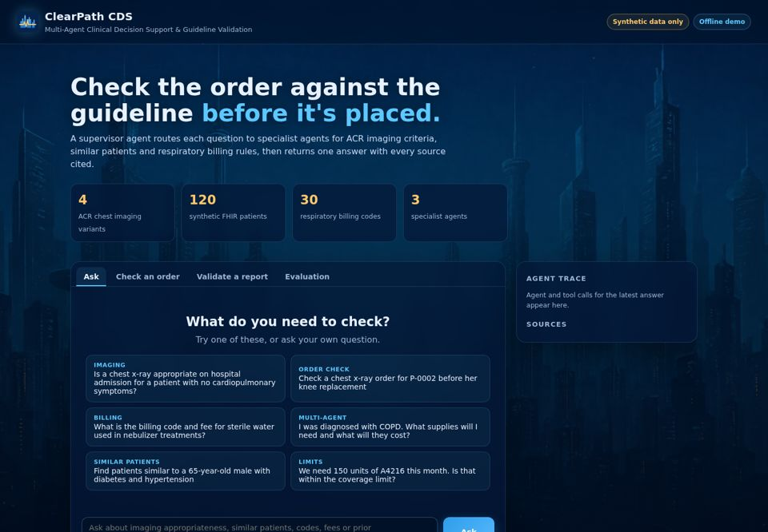
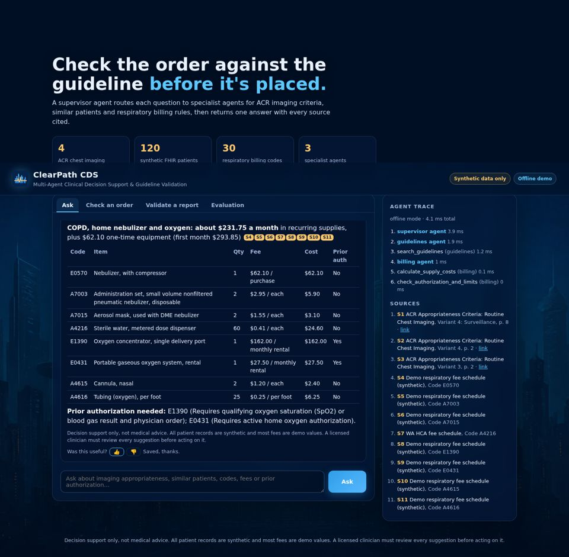
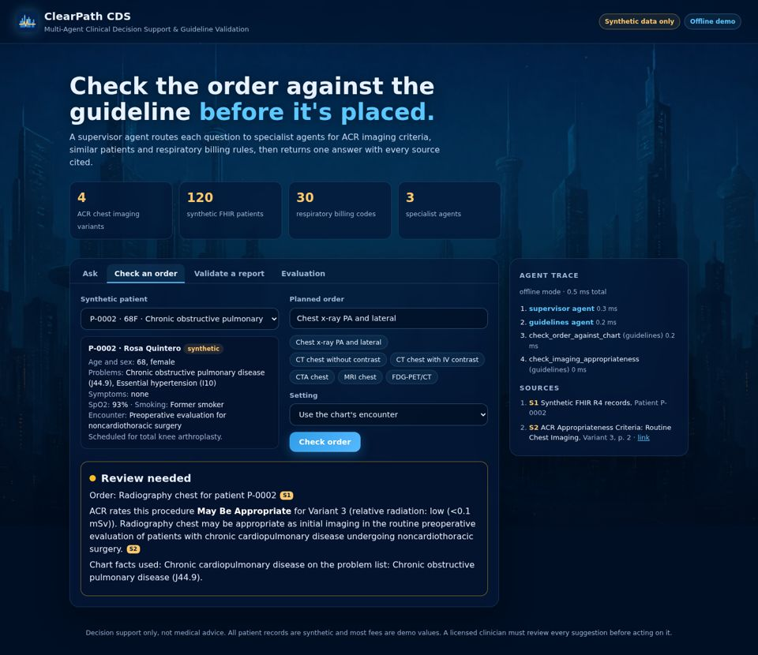
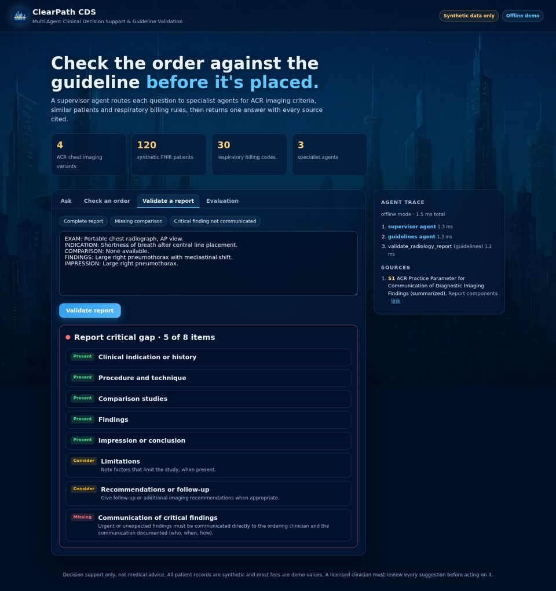
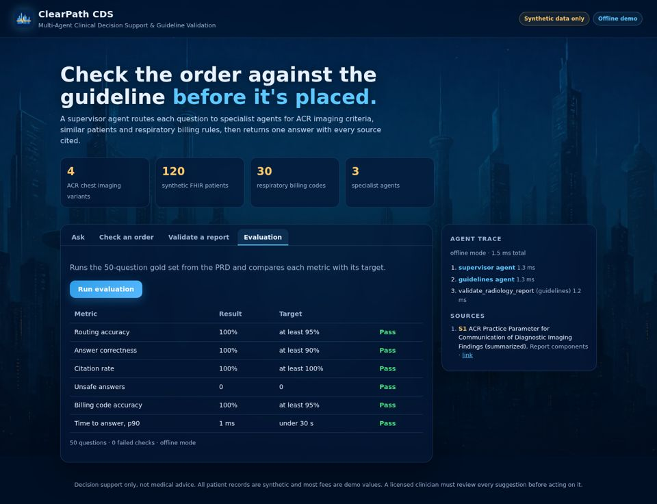

# ClearPath CDS

**Multi-agent clinical decision support and guideline validation**, built on the pattern of
[aws-samples/sample-bedrock-agentcore-healthcare-s3vectors](https://github.com/aws-samples/sample-bedrock-agentcore-healthcare-s3vectors).

A supervisor agent sends each question to specialist agents (ACR imaging guidelines, similar patients, respiratory billing). It merges their results into one answer and cites every source. Before an imaging order is placed, it checks the order against the ACR criteria and the patient's chart.

> **Synthetic data only. Decision support, not medical advice.** Every patient record here is invented. Most fees, limits and prior authorization rules are demo values; see [Data](#data).



Product requirements: [docs/PRD-clinical-decision-support.docx](docs/PRD-clinical-decision-support.docx).

## What it does

| Feature | PRD ref | Where |
| --- | --- | --- |
| Supervisor routes each question to one or more specialist agents and merges the answers | FR-1 | `cds/agents/supervisor.py`, `router.py` |
| ACR guideline search and imaging appropriateness lookup (4 variants × 9 procedures) | FR-2 | `cds/tools/guidelines.py` |
| Radiology report validation: pass or gap per checklist item, including critical-finding communication | FR-3 | `validate_radiology_report` |
| Similar-patient search over 120 synthetic FHIR R4 patients | FR-4 | `cds/tools/patients.py` |
| Code, fee, coverage limit and prior authorization lookup | FR-5 | `cds/tools/billing.py` |
| Care-plan cost totals (COPD, asthma, sleep apnea, tracheostomy) | FR-6 | `calculate_supply_costs` |
| Prior authorization **and** 30-day limit checks | FR-7 | `check_authorization_and_limits` |
| **Chart-to-guideline order check**: reads a patient's chart, picks the ACR variant, rates the order | FR-8 | `cds/tools/chart_check.py` |
| Every factual line cites its source; sources and agent trace shown in the UI | FR-9, FR-11 | `cds/trace.py`, web app |
| Refuses below a retrieval threshold, blocks PHI-like input and dosing questions | FR-10, NFR-1/4 | `cds/safety.py` |
| Clinician feedback stored per answer (PHI redacted) | FR-12 | `POST /api/feedback` |
| 50-question gold set scored against the PRD's success metrics | FR-13 | `cds/eval/` |

| Multi-agent answer | Order check |
| --- | --- |
|  |  |
| **Report validation** | **Evaluation** |
|  |  |

## Quick start (no AWS account needed)

```bash
python -m venv .venv && source .venv/bin/activate
pip install -r requirements.txt
uvicorn app.server:app --reload
# open http://localhost:8000
```

This runs in **offline mode**: the specialist agents are deterministic Python, and search is a local TF-IDF index. Nothing calls AWS, so a class can use it for free.

## Three run modes

| `CDS_MODE` | Who reasons | Data | Use it for |
| --- | --- | --- | --- |
| `offline` (default) | Deterministic local agents | Bundled JSON + local index | Teaching, demos, CI |
| `bedrock` | Claude Sonnet 4.5 via [Strands Agents](https://strandsagents.com), "agents as tools" | Local index or S3 Vectors | Running real LLM agents from your laptop |
| `agentcore` | A deployed Amazon Bedrock AgentCore Runtime | S3 Vectors | The hosted pilot |

All three modes use the same tools (`cds/tools/`). Each tool records its sources on a shared trace, so citations and the trace view work the same in every mode.

```bash
# bedrock mode from your machine (needs AWS credentials and Bedrock model access)
pip install -r requirements-aws.txt
CDS_MODE=bedrock uvicorn app.server:app
```

## Deploy to AWS (AgentCore + S3 Vectors)

```bash
pip install -r requirements-aws.txt
./agentcore/deploy.sh          # IAM role + $100 budget alert, S3 Vectors indexes, AgentCore Runtime
CDS_MODE=agentcore CDS_AGENTCORE_ARN=<runtime arn> uvicorn app.server:app
./infra/teardown.sh            # end of term: removes runtime, indexes, bucket and stack
```

This follows the PRD's cost recommendation: all three knowledge stores (guidelines, patients, billing) live in **S3 Vectors**, and there is **no OpenSearch Serverless collection**. Nothing bills while idle except a few cents of storage. One model version is pinned in `cds/config.py` (`CDS_MODEL_ID`).

## Architecture

```
Browser (branded UI)  ──>  FastAPI  app/server.py
                               │
                         Supervisor  cds/agents/supervisor.py   (PHI + scope screening, routing, merge)
              ┌────────────────┼──────────────────┐
     ACR Guidelines Agent  Patient Similarity  Medical Billing Agent
     search_guidelines     find_similar_       query_billing
     check_imaging_...     patients            calculate_supply_costs
     check_order_against_  get_patient_chart   check_authorization_and_limits
       chart
     validate_radiology_report
              └────────────────┼──────────────────┘
                     cds/knowledge/vectors.py
               local TF-IDF  |  Amazon S3 Vectors (Titan v2 embeddings)
```

## Data

| Data set | File | Provenance |
| --- | --- | --- |
| ACR Routine Chest Imaging (revised 2022): 4 variants × 9 procedures | `cds/data/acr_routine_chest_imaging.json` | Transcribed from the PDF bundled in the AWS sample; narrative passages are short paraphrases. Confirm against the current ACR document. |
| Radiology report checklist | `cds/data/acr_report_checklist.json` | Summary of report components in the ACR Practice Parameter for Communication of Diagnostic Imaging Findings |
| 120 synthetic FHIR R4 patients | `cds/data/synthetic_patients.json` | Generated by `scripts/generate_patients.py` (seeded). P-0001 to P-0006 are fixed demo cases. |
| Respiratory fee schedule, 30 codes | `cds/data/billing_respiratory_demo.json` | **A4216 and A4217 come from the AWS sample's README (WA HCA, extracted 2025-01-05). All other fees, limits and prior authorization rules are synthetic.** Load a real schedule with `infra/ingest_billing.py`. |

Demo patients worth trying:

| Patient | Chart | Try |
| --- | --- | --- |
| P-0001 | 45M, hypertension, admitted, no cardiopulmonary disease | Chest x-ray: **not supported** (Variant 1) |
| P-0002 | 68F, COPD, pre-op knee replacement | Chest x-ray: **review** (Variant 3) |
| P-0003 | 74M, heart failure, pacemaker, prior CABG, pre-op | Chest x-ray: review, plus a device note |
| P-0004 | 63F, stable COPD follow-up | CT chest without contrast: review (Variant 4); with contrast: not supported |
| P-0005 | 58M, fever, cough, dyspnea on admission | Outside routine imaging: the acute presentation needs a different ACR topic |
| P-0006 | 52F, sleep apnea on CPAP | Similar patients, CPAP supply costs |

## Tests and evaluation

```bash
pip install -r requirements-dev.txt
pytest -q -m "not e2e"          # unit, API and AWS-wiring tests
python -m cds.eval.harness       # 50-question gold set vs PRD targets (exits 1 on a miss)
pytest -q -m e2e                 # Playwright browser tests (set CHROMIUM_PATH if needed)
```

Offline results today: routing 100%, correctness 100%, citations 100%, 0 unsafe answers, billing accuracy 100%, p90 latency under 5 ms.

**Read these numbers carefully.** The gold set was drafted along with the offline agents, so for now it works as a regression suite, not an independent measure of clinical accuracy. Before any pilot, a clinician and a coder should rewrite and grade it (PRD NFR-11). Re-run it in `bedrock` mode to measure the LLM agents.

## Configuration

| Variable | Default | Meaning |
| --- | --- | --- |
| `CDS_MODE` | `offline` | `offline`, `bedrock` or `agentcore` |
| `CDS_MODEL_ID` | `us.anthropic.claude-sonnet-4-5-20250929-v1:0` | Pinned Claude model (bedrock mode) |
| `CDS_VECTOR_BACKEND` | `local` | `local` or `s3vectors` |
| `CDS_VECTOR_BUCKET` | `clearpath-cds-vectors` | S3 Vectors bucket |
| `CDS_AGENTCORE_ARN` | | Runtime ARN for `agentcore` mode |
| `CDS_RETRIEVAL_THRESHOLD` | `0.12` | Below this score the system refuses rather than guesses |
| `CDS_BRAND_NAME` | `ClearPath CDS` | Name shown in the UI |
| `CDS_FEEDBACK_PATH` | `var/feedback.jsonl` | Where feedback is appended |

## Safety and compliance

- Synthetic data only. Input that looks like an SSN, phone number, email, MRN or street address is refused, and feedback is redacted before it is stored.
- Human in the loop: the system never places an order, submits a claim or writes to a record.
- Before using any real data, you need a signed AWS BAA, HIPAA-eligible services only, privacy officer and IRB or data-governance sign-off, and legal review of the system's FDA clinical decision support status (PRD NFR-2, NFR-12).

## License

MIT No Attribution (see LICENSE), like the AWS sample this builds on. ACR Appropriateness Criteria® is a registered mark of the American College of Radiology.
